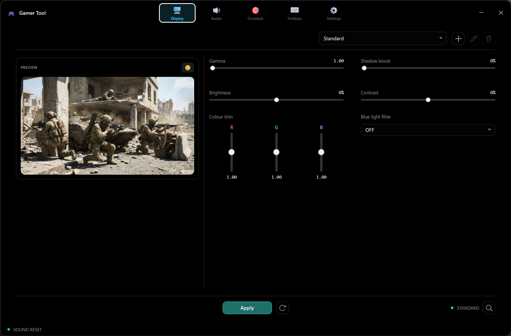
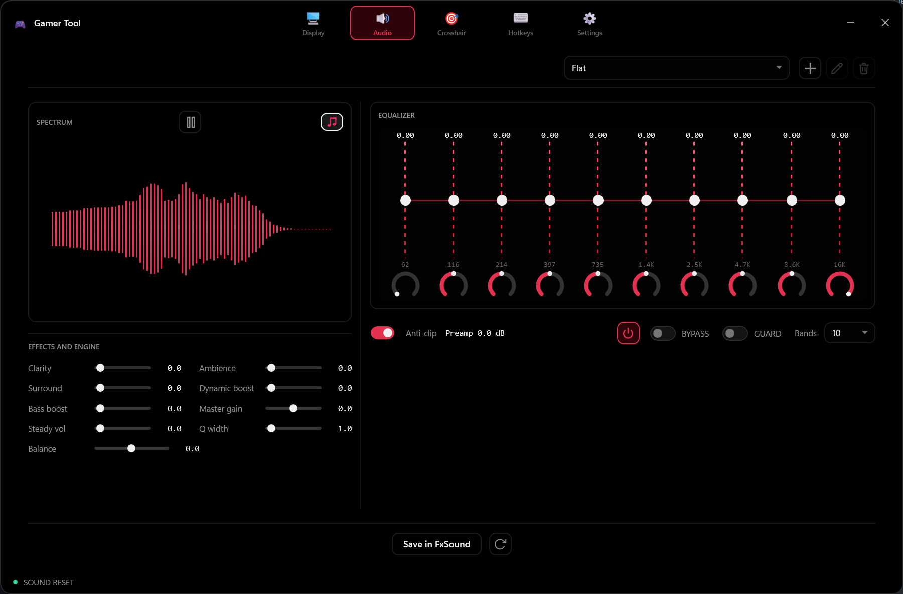
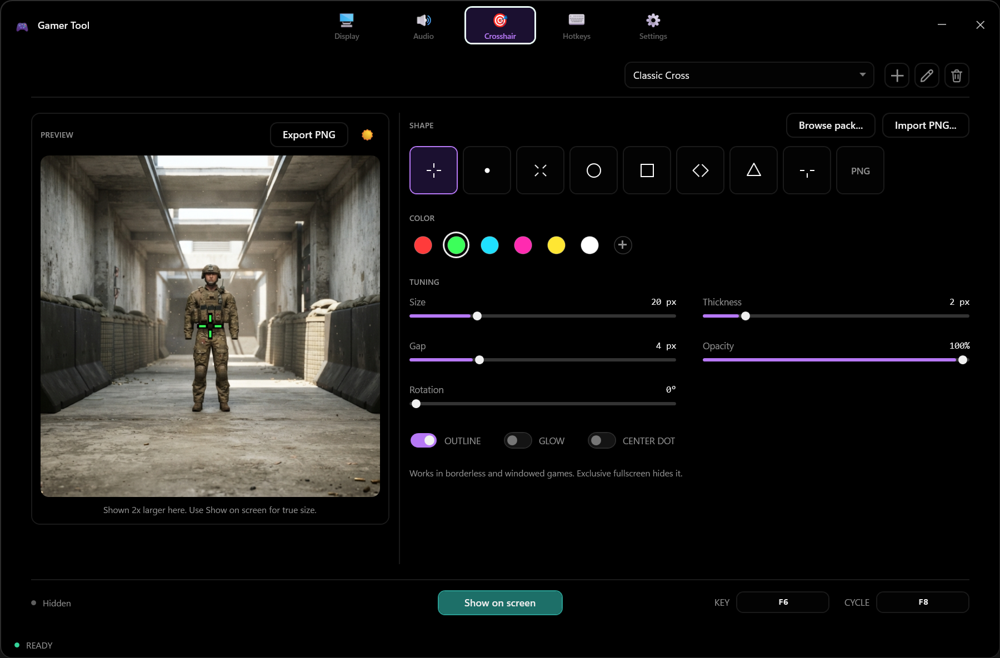
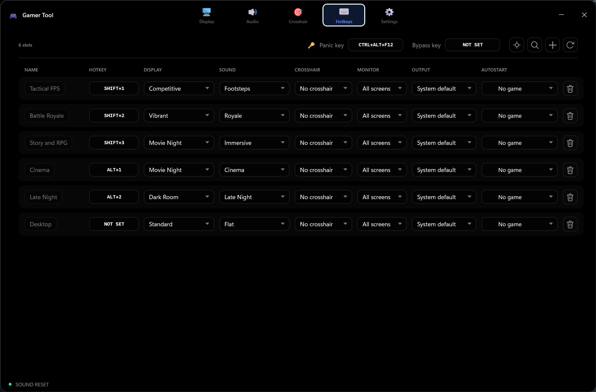
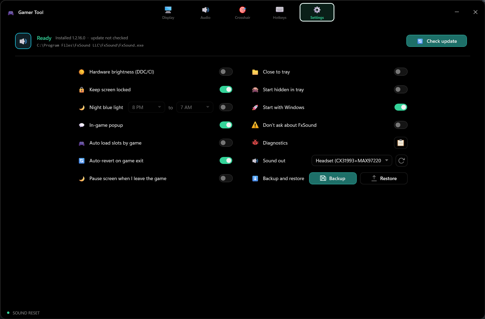

# 🎮 Gamer Tool

**Switch your screen and sound presets instantly with a single key.**

Boost shadow brightness to spot enemies in dark games, switch to a warm night mode, or enhance footsteps in your headset—all with one hotkey or automatically when a game launches.

[📥 **Download Latest Release (GamerTool.exe)**](https://github.com/MyLittlePrimordia/Gamer-Tool/releases/latest)  
*Zero install. Just download and run.*

---

## 📸 Screenshots

<table>
  <tr>
    <td width="50%"></td>
    <td width="50%"></td>
  </tr>
  <tr>
    <td width="50%"></td>
    <td width="50%"></td>
  </tr>
  <tr>
    <td width="50%"></td>
    <td width="50%"></td>
  </tr>
</table>

---

## ⚡ What it does

- 🖥️ **Display Presets:** Instant profiles like *Competitive*, *Cinema*, *Daylight*, and *Night*, plus custom brightness, contrast, and color dials.
- 🎧 **Audio Presets & EQ:** Sound profiles and a multi-band equalizer (via free [FxSound](https://www.fxsound.com/)) with automatic distortion protection.
- ⌨️ **One-Key Switching:** Link a screen preset + a sound preset to a single hotkey (e.g. `Ctrl+Shift+1`) or have it turn on automatically when a game starts.
- ▶️ **Play With Profile:** A slot's Play button loads that slot - screen, sound, Windows audio routing, HDR - *before* it starts the game, then puts everything back when you exit. A game from Steam or Epic is started by its own launcher, so it behaves exactly as it does from the store; a shortcut can do the same from outside the window.
- 🎯 **Crosshair Overlay:** Eight minimal shapes in six high-contrast colors (or any color from the built-in picker), plus a browsable pack of ready-made crosshairs and your own PNG, GIF, WebP, JPG or BMP files, animated or not. Size, thickness, gap, opacity, rotation, outline, glow and a center dot with its own color and size all work on shapes *and* pictures, and the presets that ship are the settings players actually run rather than one demo per shape. Seven optional movement effects - pulse, spin, breathe, sheen, sparks, ripple and cycle - are there for anyone who wants them, and off by default. Each arrives at its own speed and reach rather than at fifty on both sliders, and the dropdown draws each one on a small crosshair so you can see what it does before you pick it. Pick one per slot, or toggle and cycle them with their own hotkeys.
- 🪶 **Lightweight & Clean:** No accounts, no background telemetry, no installer. Lives quietly in your system tray, where you can toggle or switch your crosshair without opening the window.

## 🎯 Crosshair notes

- It is a small click-through window that only draws pixels. It never touches the game, injects anything or reads game memory. A still crosshair uses no CPU while sitting on screen: WPF keeps what was drawn and redraws only when a setting changes. The window is the size of the crosshair plus a margin - under a hundred pixels on a side - and never the size of the screen.
- It shows over **borderless** and **windowed** games. A game in true **exclusive fullscreen** hides it, so switch the game to borderless.
- Some tournaments and leagues ban any overlay. Turn it off for those.
- **Add your own crosshair PNGs:** click **Browse pack...** on the Crosshair tab, then **Open folder**, and drop any PNG, GIF, WebP, JPG or BMP files (any file names) into it. Animated GIFs and WebPs play in the browser, so you can see a loop before choosing it. The folder is `%AppData%\GamerTool\crosshair-pack` (beside the program in portable mode) and is created on first launch from the pictures built into the exe. It is read each time the browser opens, so new files just appear. In the source tree the starter pictures live in `app\Assets\crosshairs` and are embedded at build time.
- White-on-transparent pictures work best, because the color slider tints them. Thickness above 2 makes a picture's lines bolder, and outline, glow, opacity, size and rotation apply to it too.
- **Size** measures the crosshair itself, not the empty space round it in the file, so a small picture can be made as large as any other and a wide one keeps its shape.
- **Presets:** the ones that ship are archetypes, not one demo per shape - a two pixel tactical cross, the same with a dot, a dot on its own, a wide tracking frame, a T with nothing over the head. Sizes are screen pixels, so a preset is the same crosshair at any resolution.
- **Center dot** has a color and a size of its own, and both follow the crosshair until you change them: the color follows the crosshair's, the size the line's thickness. An older profile therefore draws exactly as it did, and the dot can be made thin enough for a one pixel crosshair or small enough not to fill the gap.
- **Reset** (beside **Show on screen**) puts the color and every tuning slider back to its defaults, keeping the shape and the picture. A picture with colors of its own goes back to them, which is the way out of a color picked over a multi-colored animation.
- **Own colors** under the swatches draws a picture in the colors it came with instead of the one you picked. It is turned on by itself for any picture that has colors of its own - a multi-colored animated GIF, or a photograph - so an animation no longer arrives as one flat color. The color you picked still paints the glow, and the switch is there either way.
- **Import...** is for a one-off file. Imports of PNG, GIF, JPG and BMP are checked, shrunk and re-saved by the app, and an animated GIF keeps its frame timings.
- **Effects** are per crosshair and off by default, so every preset saved before they existed opens exactly as it did. They move light or the colour around a middle that never moves, and each one adapts to what is actually drawn: sparks leave the tips of a cross, the rim of a ring and the border of a picture rather than the empty middle; a sheen is a highlight crossing the ink so it catches the shape and nothing else; a ripple sends two bands in the crosshair's own shape - a cross sends out crosses, a box boxes, a ring rings - outward past it and fades them. Every effect draws marks of its own, so none of them needs the Glow switch and the switch stays yours. They are decoration, and the app says so: a game's own dynamic crosshair is information about spread, not an aesthetic. An animated crosshair redraws about sixty times a second while it is on the screen and stops the moment it is hidden, so an effect that is not showing costs nothing.
- **Breathe** is the one effect that changes nothing but brightness: it dims to about two thirds of the crosshair's opacity and comes back, over four to eight seconds. It is deliberately the deepest of the quiet effects, because a dimming shallow enough to be tasteful turned out to be a dimming nobody could see.
- **A white or pale yellow crosshair's ripple** is drawn with a soft shadow under the wave, in its own hue. A white wave on a bright scene otherwise looks exactly like no effect at all, which is what it was reported as; every other colour in the row carries itself and is drawn as it always was.
- **Nothing moves the aim point.** The busier ideas - a glitch tearing the shape, comets orbiting it, a light chasing along its ink, lights blinking on its tips - were built and then taken out: beside the middle of the screen they pull the eye away from the one pixel that matters. What is left changes size, brightness, colour or light on the ink and leaves the middle where it is. Nothing alternates brightness faster than three times a second, which is the rate [WCAG 2.3.1](https://www.w3.org/WAI/WCAG22/Understanding/three-flashes-or-below-threshold) treats as the point where a flash becomes a seizure risk.
- **OLED guard** is one switch, off by default, in the row that also says whether a crosshair is on the screen. With it on, a crosshair that is up steps aside after fifteen minutes without keyboard or mouse input and comes back the moment you touch either; it never fires while a game is fullscreen, because Windows reports a controller as no input at all and a crosshair that vanished mid-round would be worse than the wear it was avoiding. It is the only protection here with a real effect: OLED wear is cumulative, and the monitor's own pixel shift and logo dimming are not documented to notice a shape this small. The reading beside it counts how long the crosshair has been up.
- **Export PNG** saves the current crosshair as a transparent picture at its real size. An exported file is always the still crosshair, whatever effect the tab is set to.
- The crosshair appears on the monitor that holds the foreground (game) window. Screen recording will include it.

---

## 🚀 Quick Start (3 Steps)

1. **Download & Run:** Grab [`GamerTool.exe`](https://github.com/MyLittlePrimordia/Gamer-Tool/releases/latest) and double-click it.
2. *(Optional)* **Enable Audio:** If you want audio presets, install [FxSound](https://www.fxsound.com/) (free—there's a direct button on the Settings tab).
3. **Set your Hotkey:** 
   - Open the **Hotkeys** tab and click **+**.
   - Pick your screen preset, sound preset, and hotkey.
   - Press that key in-game to toggle your settings!

---

## 📋 Requirements

- **Windows 10 or 11**
- [FxSound](https://www.fxsound.com/) *(free, only needed if you want the Audio tab)*

---

<details>
<summary><b>🛠️ Advanced Notes & Hardware Brightness</b></summary>

- **Verify setup:** the Settings row of that name tries brightness, HDR and Windows sound routing on this PC, puts every one of them back, and lists what answered. If a feature does nothing on your machine, that list is the first thing to paste into a report.
- **Hardware Brightness (DDC/CI):** Off by default. Some monitors support changing real backlight levels directly over the display cable. If a monitor fails to respond twice, Gamer Tool disables it safely to prevent freezing.
- **Settings Location:** Everything is stored locally in `%APPDATA%\GamerTool`. Copy this folder if you want to move your setup to a new PC.
- **Backups:** **Backup and restore** writes one file holding your presets, slots and keys *and the crosshair pictures they use*, so a setup restored on another PC looks the same. If a picture is not in the file and not already on that PC, the restore says so rather than leaving a crosshair pointing at nothing.
- **Portable mode:** Put a `settings.json` next to `GamerTool.exe` and the whole setup moves into that folder — settings *and* the log. Handy for a USB stick. Leave the file out and nothing changes.
- **Accessibility:** Full keyboard navigation is supported. Every dial and control can be navigated using <kbd>Tab</kbd>, arrow keys, <kbd>Page Up</kbd>/<kbd>Down</kbd>, and <kbd>Esc</kbd>.
</details>

<details>
<summary><b>💻 Building from Source</b></summary>

Requires the [.NET 10 SDK](https://dotnet.microsoft.com/download).

```powershell
dotnet publish app/GamerTool.csproj -c Release -o publish
```

This outputs a standalone `GamerTool.exe` in the `publish` folder.
</details>